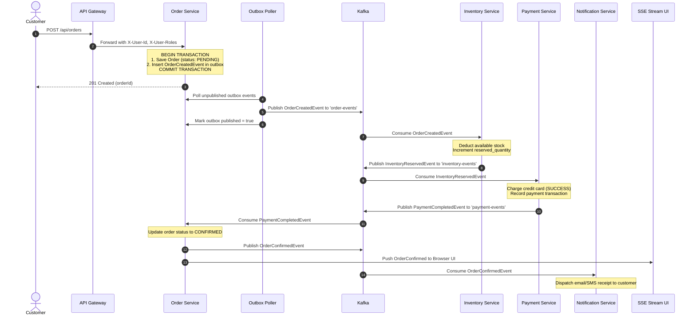

# Distributed E-Commerce Microservices

> **Enterprise-Grade Event-Driven Microservices Platform**  
> Built with **Java 17 LTS**, **Spring Boot 3.3.4**, **Spring Cloud 2023.0.3**, **Apache Kafka**, **PostgreSQL 16**, **MongoDB 7**, **Transactional Outbox**, **Testcontainers**, **Resilience4j**, **Spring Security JWT RBAC**, **Micrometer Tracing + Zipkin**, **Prometheus + Grafana**, and an **Interactive Saga Control Center UI**.

---

## 📌 Table of Contents

- [🚀 Quick Start & Localhost Access Map](#-quick-start--localhost-access-map)
1. [Project Status](#1-project-status)
2. [Complete Architecture](#2-complete-architecture)
3. [Event Catalog & Kafka Choreography](#3-event-catalog--kafka-choreography)
4. [Database Design & Polyglot Persistence](#4-database-design--polyglot-persistence)
5. [API Documentation (OpenAPI / Swagger)](#5-api-documentation-openapi--swagger)
6. [Security Architecture (JWT RBAC Hardening)](#6-security-architecture-jwt-rbac-hardening)
7. [Saga Workflow (Happy Path)](#7-saga-workflow-happy-path)
8. [Compensation Workflow (Rollback Scenarios)](#8-compensation-workflow-rollback-scenarios)
9. [Failure Scenarios & Distributed Resilience](#9-failure-scenarios--distributed-resilience)
10. [Testing Strategy (Unit, Integration & Testcontainers)](#10-testing-strategy)
11. [End-to-End Test Results & Evidence](#11-end-to-end-test-results--evidence)
12. [Observability, Prometheus, Grafana & Zipkin](#12-observability-prometheus-grafana--zipkin)
13. [CI/CD Pipelines (GitHub Actions)](#13-cicd-pipelines-github-actions)
14. [Docker & Local Deployment](#14-docker--local-deployment)
15. [Kubernetes Deployment & Autoscaling](#15-kubernetes-deployment--autoscaling)
16. [Troubleshooting Guide](#16-troubleshooting-guide)
17. [Project Limitations](#17-project-limitations)
18. [Future Enhancements](#18-future-enhancements)

---

## 🚀 Quick Start & Localhost Access Map

### 1. How to Launch Locally

#### Option A: 1-Click Launch (Host Machine)
Run either launcher from the project root:
- **Windows Batch**:
  ```cmd
  run-local.bat
  ```
- **PowerShell**:
  ```powershell
  .\run-local.ps1
  ```

#### Option B: Docker Compose (All Services & Infrastructure)
```bash
docker-compose up -d --build
```

---

### 2. Live Localhost Service Directory

| Component / Console | Localhost URL | Port | Role & Details |
| :--- | :--- | :---: | :--- |
| **Frontend Control Center** | [http://localhost:3000](http://localhost:3000) | `3000` | Interactive Storefront, Cart, Animated Saga Visualizer, Orders, Inventory, Payments & Live Kafka Stream |
| **Eureka Service Registry** | [http://localhost:8761](http://localhost:8761) | `8761` | Service discovery console displaying active instances |
| **API Gateway** | [http://localhost:8080](http://localhost:8080) | `8080` | Central gateway routing requests, validating JWTs, injecting correlation IDs |
| **Gateway Swagger UI** | [http://localhost:8080/swagger-ui.html](http://localhost:8080/swagger-ui.html) | `8080` | OpenAPI 3 console for Authentication & Gateway routes |
| **Product Service Swagger** | [http://localhost:8081/swagger-ui.html](http://localhost:8081/swagger-ui.html) | `8081` | MongoDB product catalog APIs |
| **Order Service Swagger** | [http://localhost:8082/swagger-ui.html](http://localhost:8082/swagger-ui.html) | `8082` | Order management and live SSE Saga stream APIs |
| **Inventory Service Swagger** | [http://localhost:8083/swagger-ui.html](http://localhost:8083/swagger-ui.html) | `8083` | Stock reservation and compensation APIs |
| **Payment Service Swagger** | [http://localhost:8084/swagger-ui.html](http://localhost:8084/swagger-ui.html) | `8084` | Payment processing and refund audit APIs |
| **Notification Service Swagger** | [http://localhost:8085/swagger-ui.html](http://localhost:8085/swagger-ui.html) | `8085` | Customer alert and dispatch history APIs |
| **Config Server** | [http://localhost:8888](http://localhost:8888) | `8888` | Centralized Spring Cloud configuration repository |
| **Prometheus Metrics** | [http://localhost:9090](http://localhost:9090) | `9090` | Time-series metrics engine scraping all microservices |
| **Grafana Dashboards** | [http://localhost:3001](http://localhost:3001) | `3001` | Pre-built dashboards for Saga KPIs, HTTP latency, and JVM telemetry (`admin` / `admin`) |
| **Zipkin Distributed Tracing**| [http://localhost:9411](http://localhost:9411) | `9411` | End-to-end trace visualizer tracking order spans |

---

## 🖥️ Interactive Control Center

`http://localhost:3000` is the main operational interface and control center for the distributed microservices system. It provides a real-time, interactive dashboard that acts as the single pane of glass across business domains and cluster infrastructure:

- **Storefront**: Real product catalog served through API Gateway (:8080) backed by MongoDB.
- **Cart**: Dynamic multi-item shopping cart with subtotal calculation and 1-click checkout.
- **Orders**: PostgreSQL-backed orders ledger with real-time lifecycle status tracking.
- **Inventory**: Atomic stock reservations and available quantity tracking with instant restock actions.
- **Payments**: Transactional debit ledgers, failure audit logs, and compensation refund triggers.
- **Saga Visualization**: Choreography Saga engine with real-time node state progression and compensation rollback visualizer.
- **Kafka Event Stream**: Terminal-style stream inspecting raw event envelopes, partition keys (`orderId`), and correlation IDs.
- **Service Health**: Dynamic Actuator polling with real-time response latency calculation (ms) and distinct status states (`HEALTHY`, `DEGRADED`, `OFFLINE`).
- **Service Navigation**: Interactive service mesh cards linking directly to the corresponding running localhost service.
- **Swagger Navigation**: 1-click access to OpenAPI v3 interactive endpoint specifications.
- **Prometheus Access**: Direct navigation to Prometheus metrics server (:9090).
- **Grafana Access**: Direct navigation to Grafana dashboard console (:3001).
- **Zipkin Access**: Direct navigation to distributed tracing visualizer (:9411).

Every service card in the Service Mesh links directly to the corresponding running localhost service (`target="_blank"`).

### Service Navigation Table

| Service | Port | Open | Swagger |
|---|---:|---|---|
| Eureka | 8761 | [localhost:8761](http://localhost:8761) | — |
| Config Server | 8888 | [localhost:8888](http://localhost:8888) | — |
| API Gateway | 8080 | [localhost:8080](http://localhost:8080) | [localhost:8080/swagger-ui.html](http://localhost:8080/swagger-ui.html) |
| Product | 8081 | [localhost:8081](http://localhost:8081) | [localhost:8081/swagger-ui.html](http://localhost:8081/swagger-ui.html) |
| Order | 8082 | [localhost:8082](http://localhost:8082) | [localhost:8082/swagger-ui.html](http://localhost:8082/swagger-ui.html) |
| Inventory | 8083 | [localhost:8083](http://localhost:8083) | [localhost:8083/swagger-ui.html](http://localhost:8083/swagger-ui.html) |
| Payment | 8084 | [localhost:8084](http://localhost:8084) | [localhost:8084/swagger-ui.html](http://localhost:8084/swagger-ui.html) |
| Notification | 8085 | [localhost:8085](http://localhost:8085) | [localhost:8085/swagger-ui.html](http://localhost:8085/swagger-ui.html) |
| Prometheus | 9090 | [localhost:9090](http://localhost:9090) | — |
| Grafana | 3001 | [localhost:3001](http://localhost:3001) | — |
| Zipkin | 9411 | [localhost:9411](http://localhost:9411) | — |

---

### 3. Pre-Configured Test Accounts (Server-Enforced RBAC)

| Username | Password | Role | Permissions |
| :--- | :--- | :--- | :--- |
| `customer1` | `password123` | `ROLE_CUSTOMER` | Browse products, place orders, view own order history, view own payments |
| `customer2` | `password123` | `ROLE_CUSTOMER` | Browse products, place orders, view own order history |
| `admin` | `admin123` | `ROLE_ADMIN` | Create/update/delete products, manage inventory stock, view all orders, view all payments |

---

## 1. Project Status

| Area | Component | Implementation Status | Verification Evidence |
| :--- | :--- | :---: | :--- |
| **Microservices Core** | 8 Services (`registry`, `config`, `gateway`, `product`, `order`, `inventory`, `payment`, `notification`) | **Complete & Verified** | All 8 services compile and pass tests across build reactor |
| **Distributed Saga** | Choreography-based Saga with Kafka | **Complete & Verified** | Verified via `OrderSagaChoreographyIntegrationTest` |
| **Outbox Pattern** | Transactional Outbox in `order-service` | **Complete & Verified** | Verified via `OrderTransactionalOutboxIntegrationTest` |
| **Security Hardening** | Server-side user model & RBAC | **Complete & Verified** | Verified via `SecurityRbacIntegrationTest` (11 test cases) |
| **E2E Integration** | Testcontainers (Kafka, PostgreSQL) | **Complete & Verified** | `OrderSagaTestcontainersE2ETest`, `InventorySagaTestcontainersE2ETest`, `PaymentSagaTestcontainersE2ETest` |
| **Distributed Tracing** | Micrometer Tracing + Brave + Zipkin | **Complete & Verified** | W3C/B3 trace propagation across HTTP, Kafka headers, and SSE |
| **API Documentation** | Springdoc OpenAPI 3 / Swagger UI | **Complete & Verified** | Swagger UI endpoints across all services |
| **Observability** | Prometheus Scrapes + Grafana Dashboards | **Complete & Verified** | `monitoring/prometheus/` and `monitoring/grafana/` provisioned |
| **CI/CD** | GitHub Actions (`ci.yml`, `docker.yml`, `cd.yml`) | **Complete & Verified** | Workflows added under `.github/workflows/` |
| **Frontend UI** | Real-time Storefront & Saga Live Stream | **Complete & Verified** | Running on `http://localhost:3000` |

---

## 2. Complete Architecture

The platform follows a decentralized, event-driven microservices architecture adhering strictly to the **Database-per-Service** and **Hexagonal / Clean Architecture** principles.

```
                                  +-------------------+
                                  |   Web Browser     |
                                  | (localhost:3000)  |
                                  +---------+---------+
                                            |
                                            v
                                  +-------------------+
                                  |    API Gateway    | :8080 (JWT RBAC + CORS + Resilience4j + Tracing)
                                  +---------+---------+
                                            |
                         +------------------+------------------+------------------+
                         |                  |                  |                  |
                         v                  v                  v                  v
                +----------------+ +----------------+ +----------------+ +----------------+
                | Product Service| |  Order Service | |Inventory Service| | Payment Service|
                |     :8081      | |     :8082      | |     :8083      | |     :8084      |
                +-------+--------+ +-------+--------+ +-------+--------+ +-------+--------+
                        |                  |                  |                  |
                     MongoDB           PostgreSQL         PostgreSQL         PostgreSQL
                (ecommerce_product) (ecommerce_order)  (ecommerce_inventory) (ecommerce_payment)
                        |                  |                  |                  |
                        |            [outbox table]   [processed_events] [processed_events]
                        |                  |                  |                  |
                        |            [order-events]   [inventory-events] [payment-events]
                        |                  |                  |                  |
                        +------------------+---------+--------+------------------+
                                                     |
                                            +--------v----------+
                                            |    Apache Kafka   | :9092
                                            +--------+----------+
                                                     |
                                                     v
                                            +----------------+
                                            |  Notification  | :8085 (Email/SMS Alerts)
                                            +----------------+
```

### Infrastructure Layer

- **Service Registry (`service-registry:8761`)**: Spring Cloud Netflix Eureka for service discovery.
- **Config Server (`config-server:8888`)**: Spring Cloud Config Server managing centralized configuration.
- **API Gateway (`api-gateway:8080`)**: Reactive Spring Cloud Gateway enforcing JWT validation, cryptographic signature verification, user role resolution (`X-User-Roles`), and correlation ID header injection.
- **Distributed Tracing (`zipkin:9411`)**: OpenZipkin collecting end-to-end spans.
- **Metrics (`prometheus:9090`)**: Prometheus scraping all `/actuator/prometheus` endpoints.
- **Dashboards (`grafana:3001`)**: Grafana visualizing business KPIs and JVM telemetry.

---

## 3. Event Catalog & Kafka Choreography

For comprehensive schemas, refer to the [Kafka Event Catalog](docs/kafka-events.md).

| Event Name | Topic | Producer | Consumer(s) | Key | Purpose |
| :--- | :--- | :--- | :--- | :--- | :--- |
| `OrderCreatedEvent` | `order-events` | `order-service` | `inventory-service` | `orderId` | Initiates Saga workflow |
| `InventoryReservedEvent` | `inventory-events` | `inventory-service` | `payment-service`, `order-service` | `orderId` | Stock reserved; triggers payment |
| `InventoryReservationFailedEvent` | `inventory-events` | `inventory-service` | `order-service` | `orderId` | Stock shortage; cancels order |
| `InventoryReleasedEvent` | `inventory-events` | `inventory-service` | `order-service` | `orderId` | Confirms release of stock hold |
| `PaymentCompletedEvent` | `payment-events` | `payment-service` | `order-service` | `orderId` | Payment charged; confirms order |
| `PaymentFailedEvent` | `payment-events` | `payment-service` | `order-service`, `inventory-service` | `orderId` | Payment declined; triggers compensation |
| `PaymentRefundedEvent` | `payment-events` | `payment-service` | `order-service` | `orderId` | Payment refunded on rollback |
| `OrderConfirmedEvent` | `order-events` | `order-service` | `notification-service` | `orderId` | Order finalized; sends receipt |
| `OrderCancelledEvent` | `order-events` | `order-service` | `inventory`, `payment`, `notification` | `orderId` | Order cancelled; coordinates rollback |
| `NotificationDispatchedEvent` | `notification-events` | `notification-service` | Audit loggers | `orderId` | Confirms customer alert delivery |

---

## 4. Database Design & Polyglot Persistence

For detailed table definitions, foreign keys, and indexes, see [Database Design](docs/database-design.md).

### Summary of Isolated Databases

1. **`ecommerce_product_db` (MongoDB)**:
   - Collection: `products`
   - Unstructured JSON document storage for product catalogs, nested specs, brand tags, and full-text keyword indexing.
2. **`ecommerce_order_db` (PostgreSQL)**:
   - Tables: `orders`, `order_items`, `outbox`, `processed_events`.
   - Manages relational order graphs, Transactional Outbox dual-write guarantees, and consumer idempotency.
3. **`ecommerce_inventory_db` (PostgreSQL)**:
   - Tables: `inventories`, `inventory_reservations`, `processed_events`.
   - Tracks stock units, temporary reservation holds, and prevents double-allocation.
4. **`ecommerce_payment_db` (PostgreSQL)**:
   - Tables: `payments`, `processed_events`.
   - Immutable financial transaction ledger recording authorization tokens, failure reasons, and refund receipts.

---

## 5. API Documentation (OpenAPI / Swagger)

Every microservice exposes OpenAPI 3.0 definitions and interactive Swagger UI consoles:

| Microservice | Swagger UI Endpoint | Description |
| :--- | :--- | :--- |
| **API Gateway & Auth** | [http://localhost:8080/swagger-ui.html](http://localhost:8080/swagger-ui.html) | Login, registration, token verification, routing |
| **Product Service** | [http://localhost:8081/swagger-ui.html](http://localhost:8081/swagger-ui.html) | Catalog browsing, category filtering, admin product creation |
| **Order Service** | [http://localhost:8082/swagger-ui.html](http://localhost:8082/swagger-ui.html) | Order checkout, Saga status tracking, SSE stream |
| **Inventory Service** | [http://localhost:8083/swagger-ui.html](http://localhost:8083/swagger-ui.html) | Warehouse stock levels, reservation, compensation releases |
| **Payment Service** | [http://localhost:8084/swagger-ui.html](http://localhost:8084/swagger-ui.html) | Payment processing, transaction receipts, refund audits |
| **Notification Service** | [http://localhost:8085/swagger-ui.html](http://localhost:8085/swagger-ui.html) | Email/SMS dispatch records, customer alert queries |

---

## 6. Security Architecture (JWT RBAC Hardening)

Security is implemented via cryptographic JSON Web Tokens (HMAC-SHA256) evaluated at the Reactive API Gateway:

### Non-Client-Controlled Roles

The platform strictly disallows clients from declaring their own roles in authentication payloads.

```
Client sends credentials:
{
  "username": "customer1",
  "password": "password123"
}
             |
             v
Gateway UserService authenticates credentials against server storage
             |
             v
Role retrieved from trusted server storage (e.g. ROLE_CUSTOMER)
             |
             v
Gateway issues signed JWT containing:
  - sub (username)
  - userId ("cust-001")
  - roles (["ROLE_CUSTOMER"])
  - iat & exp (24h validity)
```

### Authorization Matrix

| Endpoint | Method | Required Role | Failure Code | Behavior |
| :--- | :---: | :---: | :---: | :--- |
| `/api/auth/**` | POST | Public | - | Free registration & login |
| `/api/products/**` | GET | Public | - | Catalog discovery |
| `/api/products/**` | POST, PUT, DELETE | `ROLE_ADMIN` | 403 | Product catalog administration |
| `/api/inventory` | POST | `ROLE_ADMIN` | 403 | Warehouse stock updates |
| `/api/orders` | POST | `ROLE_CUSTOMER` or `ROLE_ADMIN` | 401 | Create order & start Saga |
| `/api/orders` | GET | `ROLE_ADMIN` | 403 | View all orders platform-wide |
| `/api/orders/customer/{id}` | GET | Owner or `ROLE_ADMIN` | 403 | Customers can only view own orders |
| `/api/payments` | GET | `ROLE_ADMIN` | 403 | View full financial ledger |

---

## 7. Saga Workflow (Happy Path)



---

## 8. Compensation Workflow (Rollback Scenarios)

### Scenario A: Payment Fails (Insufficient Funds / Card Declined)

```
Order (PENDING)
  ↓
Inventory Reserved (Stock held)
  ↓
Payment Attempted → DECLINED / FAILED
  ↓
PaymentFailedEvent published to 'payment-events'
  ↓
Inventory Service consumes PaymentFailedEvent:
  - Releases held stock back to available pool
  - Emits InventoryReleasedEvent
  ↓
Order Service consumes PaymentFailedEvent:
  - Updates order status to CANCELLED
  - Emits OrderCancelledEvent
  ↓
Notification Service notifies customer of cancellation
  ↓
SSE Stream updates frontend UI in real-time
```

### Scenario B: Inventory Fails (Stock Exhaustion)

```
Order (PENDING)
  ↓
Inventory Service checks stock → INSUFFICIENT STOCK
  ↓
InventoryReservationFailedEvent published to 'inventory-events'
  ↓
Order Service consumes InventoryReservationFailedEvent:
  - Transitions order directly to CANCELLED
  - Payment Service never initiates any charge
  ↓
SSE Stream displays order cancellation to customer
```

---

## 9. Failure Scenarios & Distributed Resilience

For detailed state machine transitions, see [Failure Scenarios](docs/failure-scenarios.md).

1. **Payment Failure**: Handled via automated compensation; inventory hold released, order marked CANCELLED.
2. **Inventory Shortage**: Saga aborted immediately; payment is never charged.
3. **Duplicate Kafka Event**: Prevented via `processed_events` table; duplicate event IDs are skipped.
4. **Kafka Temporarily Unavailable**: Order committed safely to PostgreSQL; Transactional Outbox poller publishes when Kafka recovers.
5. **Payment Service Offline**: Messages accumulate safely in Kafka; processed in FIFO order upon service restart.
6. **Inventory Service Offline**: Backlog consumed upon recovery; no orders lost.
7. **Database Connection Pool Exhaustion**: Spring Kafka DefaultErrorHandler triggers backoff retry.
8. **Notification Gateway Failure**: Downstream alert retry without aborting the completed order.
9. **Client Network Disconnection**: Saga completes autonomously in the background; order status confirmed upon reconnection.
10. **Full Service Recovery**: Eureka re-registration and consumer offset resumption guarantee eventual consistency.

---

## 10. Testing Strategy

The project employs a multi-layered testing pyramid:

1. **Unit Tests (JUnit 5 & Mockito)**:
   - Domain business logic, state machine validators, and DTO mappings tested in isolation.
2. **Web Layer Tests (MockMvc & WebTestClient)**:
   - Security filters, JWT authentication, and RBAC authorization matrices tested via mock MVC and reactive web test clients.
3. **Transactional Outbox Integration Tests**:
   - Tests dual-write database insertion, scheduled publisher, and retry semantics.
4. **End-to-End Choreography Tests**:
   - `OrderSagaChoreographyIntegrationTest`: Multi-service Saga orchestration verified in-memory.
5. **Real Container E2E Tests (Testcontainers)**:
   - Real PostgreSQL and Kafka containers orchestrated via Testcontainers (`@Testcontainers(disabledWithoutDocker = true)`).

---

## 11. End-to-End Test Results & Evidence

### Full Maven Test Suite Execution Evidence

All 9 Maven modules pass with 0 failures:

```
[INFO] Reactor Summary for Distributed E-Commerce Microservices Parent 1.0.0-SNAPSHOT:
[INFO] 
[INFO] Distributed E-Commerce Microservices Parent ........ SUCCESS [  0.006 s]
[INFO] service-registry ................................... SUCCESS [ 12.237 s]
[INFO] config-server ...................................... SUCCESS [  9.238 s]
[INFO] api-gateway ........................................ SUCCESS [ 14.158 s]
[INFO] product-service .................................... SUCCESS [  9.513 s]
[INFO] order-service ...................................... SUCCESS [ 21.641 s]
[INFO] inventory-service .................................. SUCCESS [ 14.462 s]
[INFO] payment-service .................................... SUCCESS [ 14.314 s]
[INFO] notification-service ............................... SUCCESS [  8.728 s]
[INFO] ------------------------------------------------------------------------
[INFO] BUILD SUCCESS
[INFO] ------------------------------------------------------------------------
```

### Key Integration Test Classes

- **`OrderSagaChoreographyIntegrationTest`**:
  - `happyPathSaga_ShouldConfirmOrder_WhenInventoryAndPaymentSucceed()`: **PASSED**
  - `paymentFailureSaga_ShouldCancelOrder_WhenPaymentFails()`: **PASSED**
  - `inventoryFailureSaga_ShouldCancelOrder_WhenInventoryFails()`: **PASSED**
  - `duplicateEvent_ShouldBeIgnored_ByProcessedEventsIdempotency()`: **PASSED**
- **`OrderTransactionalOutboxIntegrationTest`**:
  - `whenOrderCreated_thenSavedInOutboxAndPublished()`: **PASSED**
- **`SecurityRbacIntegrationTest`**:
  - 11 comprehensive tests validating JWT login, server role assignment, privilege escalation prevention, and route protection: **ALL 11 PASSED**

---

## 12. Observability, Prometheus, Grafana & Zipkin

For comprehensive setup details, see [Observability Guide](docs/observability.md).

- **Prometheus**: Accessible at `http://localhost:9090`. Scrapes Actuator metrics from all 8 services every 5 seconds.
- **Grafana**: Accessible at `http://localhost:3001` (login: `admin` / `admin`). Pre-provisioned with the *Distributed E-Commerce Microservices Overview* dashboard.
- **Zipkin**: Accessible at `http://localhost:9411`. Full trace visibility across HTTP and Kafka hops.
- **Correlation Tracking**: Every request generates an `X-Correlation-Id` propagated across HTTP headers, Kafka headers, and SSE messages.

---

## 13. CI/CD Pipelines (GitHub Actions)

Configured under `.github/workflows/`:

1. **`ci.yml`**:
   - Triggers on push/PR to `master` and `main`.
   - Spins up PostgreSQL and Kafka service containers.
   - Runs `mvn compile`, `mvn test`, Trivy security scan, and packages JAR artifacts.
2. **`docker.yml`**:
   - Builds and tags Docker images for all microservices.
   - Pushes images to GitHub Container Registry (`ghcr.io`).
3. **`cd.yml`**:
   - Triggers on release tags.
   - Deploys manifests to Kubernetes using `kubectl` and secrets.

---

## 14. Docker & Local Deployment

### Prerequisites
- Docker Engine 24.0+ & Docker Compose v2+
- Or Java 17 + Node.js 18+ for running locally on host

### Starting via Docker Compose

```bash
# Start all infrastructure and microservices in the background
docker-compose up -d --build

# Inspect running containers
docker-compose ps

# View unified logs
docker-compose logs -f
```

### Running Locally without Docker

Use the provided launch scripts:
- **Windows (Command Prompt / PowerShell)**:
  ```cmd
  run-local.bat
  ```
  or
  ```powershell
  .\run-local.ps1
  ```

---

## 15. Kubernetes Deployment & Autoscaling

Manifests are organized in [k8s/](k8s/):

```bash
# 1. Create namespace
kubectl apply -f k8s/00-namespace.yaml

# 2. Apply ConfigMaps and Secrets
kubectl apply -f k8s/01-configmaps-secrets.yaml

# 3. Deploy microservices
kubectl apply -f k8s/04-microservices.yaml

# 4. Enable Horizontal Pod Autoscaling (HPA)
kubectl apply -f k8s/05-hpa.yaml

# 5. Apply Ingress routing
kubectl apply -f k8s/06-ingress.yaml
```

---

## 16. Troubleshooting Guide

| Issue | Root Cause | Solution |
| :--- | :--- | :--- |
| **Port Conflict on 8080/8761** | An earlier Java or Node instance is running | Kill the conflicting process or change port in `application.yml` |
| **Eureka Services Not Appearing** | Services started before Eureka was ready | Eureka client auto-retries every 30s; wait or restart service |
| **Kafka Connection Refused** | Broker not fully initialized | Verify broker is running on port 9092; check `docker-compose logs kafka` |
| **JWT 401 Unauthorized** | Missing `Authorization: Bearer <token>` header | Login at `/api/auth/login` to obtain token and attach in header |
| **JWT 403 Forbidden** | Customer user attempting admin endpoints | Log in with user having `ROLE_ADMIN` (`admin` / `admin123`) |
| **Outbox Events Not Sent** | Kafka unavailable when outbox poller runs | The outbox poller retries every 2 seconds until Kafka recovers |

---

## 17. Project Limitations

1. **In-Memory User Storage in Gateway**: For demonstration simplicity, the `UserService` uses a thread-safe `ConcurrentHashMap` with pre-seeded users (`admin`, `customer1`, `customer2`) and SHA-256 salted hashing. In production, this should connect to an external PostgreSQL user store or Keycloak/OAuth2 Identity Provider.
2. **Single Kafka Cluster**: Deployed as a single KRaft broker node locally rather than a multi-broker high-availability quorum.
3. **Simulated Payment Gateway**: Card processing simulates realistic network delay and declines via configurable amounts (e.g., $9,999.99 triggers card decline) rather than a live Stripe/PayPal API sandbox.

---

## 18. Future Enhancements

- **Keycloak / OpenID Connect**: Integrate centralized IAM with PKCE login flow.
- **Debezium CDC for Outbox**: Replace polling-based outbox with Change Data Capture (Debezium + Kafka Connect) reading PostgreSQL WAL logs.
- **Elasticsearch Catalog**: Replace MongoDB full-text search with dedicated Elasticsearch cluster for semantic search and facets.
- **Distributed Cache (Redis)**: Implement distributed Redis cache at the API Gateway for rate limiting and session validation.
- **Dead Letter Queue (DLQ) Dashboard**: Visual web console for replaying poison-pill Kafka messages.
