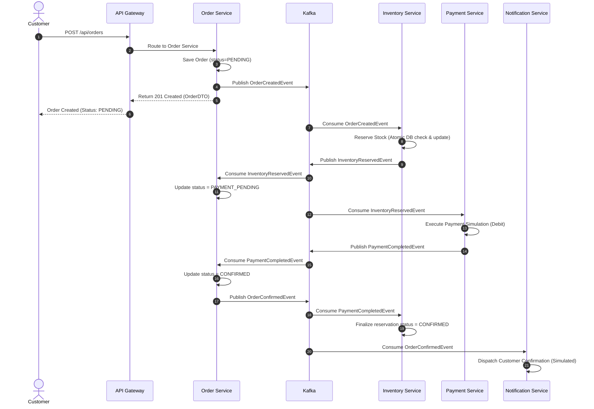
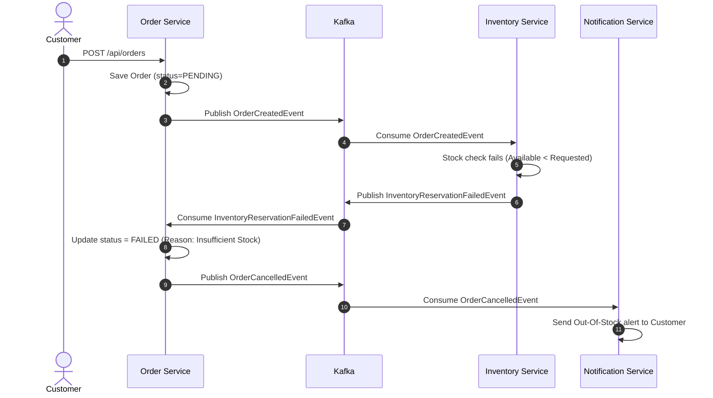
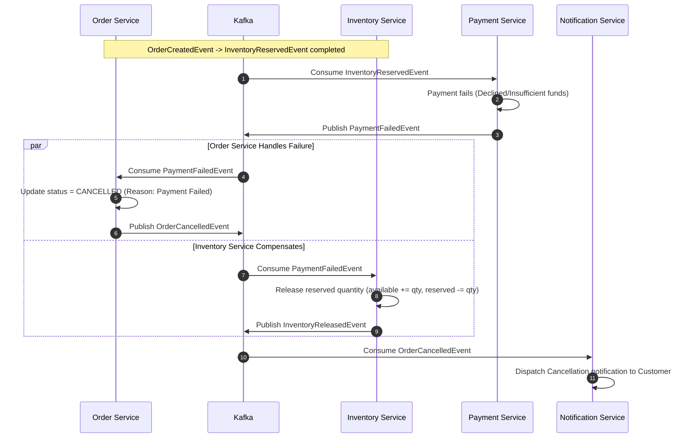

# Distributed E-Commerce Microservices — Architecture & System Design

**Document Version:** 1.0.0  
**Phase:** Phase 0 — Architecture & Project Planning  
**Status:** Approved & Baselined  

---

## 1. System Overview & Service Responsibilities

The Distributed E-Commerce Microservices platform is an event-driven, production-grade microservices system built on Java 17+, Spring Boot 3.x, Spring Cloud, Apache Kafka, PostgreSQL, and MongoDB. The system adheres strictly to the **Database-per-Service** pattern, **Domain-Driven Design (DDD)** boundaries, and a **Choreography-based Saga** pattern for distributed transactions.

```
                                  +-------------------+
                                  |   Client / SPA    |
                                  +---------+---------+
                                            | (HTTPS / REST)
                                            v
                                  +-------------------+
                                  |    API Gateway    | :8080
                                  | (Spring Cloud GW) |
                                  +----+----+----+----+
                                       |    |    |    |
     +---------------------------------+    |    |    +-----------------------------+
     |                                      |    +------------------+               |
     v                                      v                       v               v
+----+--------------+             +---------+--------+    +---------+--------+   +--+---------------+
|  Product Service  | :8081       |  Order Service   |    | Inventory Service|   | Payment Service  | :8084
|     (MongoDB)     |             |   (PostgreSQL)   |    |   (PostgreSQL)   |   |   (PostgreSQL)   |
+-------------------+             +--------+---------+    +---------+--------+   +--------+---------+
                                           |                        |                     |
                                           |                        |                     |
                                 +---------v------------------------v---------------------v---------+
                                 |                         Apache Kafka                             |
                                 |  [order-events]  [inventory-events]  [payment-events] [DLTs]     |
                                 +----------------------------------+-------------------------------+
                                                                    |
                                                                    v
                                                          +---------+--------+
                                                          |Notification Serv.| :8085
                                                          |  (Log / Alerts)  |
                                                          +------------------+
```

### Microservice Catalog & Port Allocation

| Service Name | Port | Primary Tech Stack | Database / Storage | Key Responsibilities |
|---|---|---|---|---|
| **Service Registry** | `8761` | Spring Cloud Netflix Eureka | In-Memory Registry | Dynamic service discovery, instance heartbeat tracking, load balancer registry. |
| **Config Server** | `8888` | Spring Cloud Config Server | Git / Native File (`config-repo/`) | Externalized centralized configuration, profiles (`dev`, `docker`, `prod`), live refresh. |
| **API Gateway** | `8080` | Spring Cloud Gateway (Reactive) | None (Stateless) | Reverse proxy, dynamic Eureka routing, CORS, JWT authentication filter, rate limiting, request tracing. |
| **Product Service** | `8081` | Spring Boot, Spring Data MongoDB | MongoDB (`ecommerce_product_db`) | Product catalog CRUD, category/brand indexing, flexible attributes, product search. |
| **Order Service** | `8082` | Spring Boot, Spring Data JPA, Kafka | PostgreSQL (`ecommerce_order_db`) | Order lifecycle management, Saga initiator, order status state machine, order history. |
| **Inventory Service**| `8083` | Spring Boot, Spring Data JPA, Kafka | PostgreSQL (`ecommerce_inventory_db`) | Stock level management, atomic reservations, stock release, preventing overselling. |
| **Payment Service**  | `8084` | Spring Boot, Spring Data JPA, Kafka | PostgreSQL (`ecommerce_payment_db`) | Payment transaction simulation, debit execution, refunds, transaction audit trail. |
| **Notification Service** | `8085` | Spring Boot, Spring Kafka | Stateless (Audit logs) | Consumes domain events, dispatches notifications (order confirmation, cancellation alerts, simulated emails/SMS). |

---

## 2. Service-to-Service Communication Design

To maintain loose coupling, high availability, and fault tolerance:
1. **Synchronous REST:** Restricted to ingress client queries (API Gateway to downstream services) and read-only lookups where immediate consistency is mandatory.
2. **Asynchronous Messaging:** Used for all state-changing domain workflows and distributed business processes via Apache Kafka.

### Communication Matrix

| Source | Target | Protocol | Pattern | Purpose / Description |
|---|---|---|---|---|
| **Client** | API Gateway | HTTP/REST | Synchronous | Ingress API calls (`/api/products/**`, `/api/orders/**`, etc.). |
| **API Gateway** | All Services | HTTP/REST | Synchronous | Load-balanced reverse proxy routing via Eureka service IDs (`lb://product-service`, etc.). |
| **Order Service** | Kafka | Kafka Protocol | Asynchronous Pub | Publishes `OrderCreatedEvent`, `OrderConfirmedEvent`, `OrderCancelledEvent`. |
| **Inventory Service** | Kafka | Kafka Protocol | Asynchronous Pub/Sub | Consumes `OrderCreatedEvent`; Publishes `InventoryReservedEvent` or `InventoryReservationFailedEvent`. Consumes `PaymentFailedEvent` to trigger inventory release. |
| **Payment Service** | Kafka | Kafka Protocol | Asynchronous Pub/Sub | Consumes `InventoryReservedEvent`; Publishes `PaymentCompletedEvent` or `PaymentFailedEvent`. |
| **Notification Service** | Kafka | Kafka Protocol | Asynchronous Sub | Consumes all key events (`OrderCreated`, `PaymentCompleted`, `OrderCancelled`, etc.) for notifications. |

---

## 3. Database Ownership & Data Architecture

Under no circumstances may any microservice connect to or query a database owned by another microservice. All data access occurs strictly through domain events or defined REST endpoints.

```
+--------------------+    +--------------------+    +--------------------+    +--------------------+
|  Product Service   |    |   Order Service    |    | Inventory Service  |    |  Payment Service   |
+---------+----------+    +---------+----------+    +---------+----------+    +---------+----------+
          |                         |                         |                         |
          v                         v                         v                         v
   [( MongoDB )]             [(PostgreSQL)]            [(PostgreSQL)]            [(PostgreSQL)]
ecommerce_product_db       ecommerce_order_db       ecommerce_inventory_db     ecommerce_payment_db
  - products                 - orders                  - inventory               - payments
                             - order_items             - reservations            - processed_events
                             - processed_events        - processed_events
```

### 1. Product Service (MongoDB: `ecommerce_product_db`)
- **Collection `products`:**
  - `id`: String (UUID or ObjectId)
  - `name`: String
  - `description`: String
  - `category`: String
  - `brand`: String
  - `price`: BigDecimal
  - `available`: Boolean
  - `createdAt`: Instant
  - `updatedAt`: Instant

### 2. Order Service (PostgreSQL: `ecommerce_order_db`)
- **Table `orders`:**
  - `id`: UUID (PK)
  - `customer_id`: VARCHAR(64) (Indexed)
  - `status`: VARCHAR(32) (`PENDING`, `INVENTORY_RESERVED`, `PAYMENT_PENDING`, `CONFIRMED`, `FAILED`, `CANCELLED`)
  - `total_amount`: NUMERIC(12, 2)
  - `failure_reason`: VARCHAR(255)
  - `created_at`: TIMESTAMP WITH TIME ZONE
  - `updated_at`: TIMESTAMP WITH TIME ZONE
- **Table `order_items`:**
  - `id`: BIGSERIAL (PK)
  - `order_id`: UUID (FK -> `orders.id`)
  - `product_id`: VARCHAR(64)
  - `quantity`: INT
  - `price`: NUMERIC(12, 2)
- **Table `processed_events` (Idempotency Store):**
  - `event_id`: VARCHAR(64) (PK)
  - `event_type`: VARCHAR(64)
  - `processed_at`: TIMESTAMP WITH TIME ZONE

### 3. Inventory Service (PostgreSQL: `ecommerce_inventory_db`)
- **Table `inventory`:**
  - `id`: BIGSERIAL (PK)
  - `product_id`: VARCHAR(64) (Unique, Indexed)
  - `available_quantity`: INT (CHECK >= 0)
  - `reserved_quantity`: INT (CHECK >= 0)
  - `version`: BIGINT (Optimistic Locking)
  - `updated_at`: TIMESTAMP WITH TIME ZONE
- **Table `inventory_reservations`:**
  - `id`: BIGSERIAL (PK)
  - `order_id`: UUID (Indexed)
  - `product_id`: VARCHAR(64)
  - `quantity`: INT
  - `status`: VARCHAR(32) (`RESERVED`, `RELEASED`, `CONFIRMED`)
  - `created_at`: TIMESTAMP WITH TIME ZONE
- **Table `processed_events` (Idempotency Store):**
  - `event_id`: VARCHAR(64) (PK)
  - `event_type`: VARCHAR(64)
  - `processed_at`: TIMESTAMP WITH TIME ZONE

### 4. Payment Service (PostgreSQL: `ecommerce_payment_db`)
- **Table `payments`:**
  - `id`: UUID (PK)
  - `order_id`: UUID (Unique, Indexed)
  - `customer_id`: VARCHAR(64)
  - `amount`: NUMERIC(12, 2)
  - `status`: VARCHAR(32) (`PENDING`, `SUCCESS`, `FAILED`, `REFUNDED`)
  - `transaction_id`: VARCHAR(64) (Unique)
  - `failure_reason`: VARCHAR(255)
  - `created_at`: TIMESTAMP WITH TIME ZONE
  - `updated_at`: TIMESTAMP WITH TIME ZONE
- **Table `processed_events` (Idempotency Store):**
  - `event_id`: VARCHAR(64) (PK)
  - `event_type`: VARCHAR(64)
  - `processed_at`: TIMESTAMP WITH TIME ZONE

---

## 4. Kafka Topics & Partitioning Strategy

### Topic Topology

| Topic Name | Partitions | Replication Factor | Retention | Partition Key | Description |
|---|---|---|---|---|---|
| `order-events` | 3 | 1 (Dev) / 3 (Prod) | 7 days | `orderId` | Lifecycle events emitted by Order Service. |
| `inventory-events` | 3 | 1 (Dev) / 3 (Prod) | 7 days | `orderId` | Stock reservation and release events. |
| `payment-events` | 3 | 1 (Dev) / 3 (Prod) | 7 days | `orderId` | Payment processing outcomes and refunds. |
| `notification-events` | 3 | 1 (Dev) / 3 (Prod) | 3 days | `orderId` | Dispatched notification records. |
| `order-events.DLT` | 1 | 1 (Dev) / 3 (Prod) | 14 days | `orderId` | Dead letter topic for unprocessable order events. |
| `inventory-events.DLT` | 1 | 1 (Dev) / 3 (Prod) | 14 days | `orderId` | Dead letter topic for unprocessable inventory events. |
| `payment-events.DLT` | 1 | 1 (Dev) / 3 (Prod) | 14 days | `orderId` | Dead letter topic for unprocessable payment events. |

### Partition Key Invariant
All order-related events **MUST** use `orderId.toString()` as the Kafka record key. This guarantees:
- All events for a specific order land on the exact same Kafka partition.
- In-order sequential processing per order is strictly preserved.
- Horizontal scaling across consumer instances without race conditions between order states.

---

## 5. Event Envelope & Schemas

All Kafka messages are serialized as JSON using a standardized envelope:

```json
{
  "eventId": "a7b3c2d1-0000-4000-8000-000000000001",
  "eventType": "OrderCreatedEvent",
  "orderId": "3fa85f64-5717-4562-b3fc-2c963f66afa6",
  "correlationId": "9b1deb4d-3b7d-4bad-9bdd-2b0d7b3dcb6d",
  "timestamp": "2026-10-01T12:00:00.000Z",
  "payload": {}
}
```

### Event Specifications

#### 1. `OrderCreatedEvent`
- **Topic:** `order-events`
- **Producer:** Order Service
- **Consumers:** Inventory Service, Notification Service
- **Payload:**
  ```json
  {
    "orderId": "3fa85f64-5717-4562-b3fc-2c963f66afa6",
    "customerId": "cust-1001",
    "totalAmount": 199.98,
    "items": [
      {
        "productId": "PROD-101",
        "quantity": 2,
        "price": 99.99
      }
    ]
  }
  ```

#### 2. `InventoryReservedEvent`
- **Topic:** `inventory-events`
- **Producer:** Inventory Service
- **Consumers:** Payment Service, Order Service, Notification Service
- **Payload:**
  ```json
  {
    "orderId": "3fa85f64-5717-4562-b3fc-2c963f66afa6",
    "customerId": "cust-1001",
    "totalAmount": 199.98,
    "items": [
      {
        "productId": "PROD-101",
        "quantity": 2
      }
    ]
  }
  ```

#### 3. `InventoryReservationFailedEvent`
- **Topic:** `inventory-events`
- **Producer:** Inventory Service
- **Consumers:** Order Service, Notification Service
- **Payload:**
  ```json
  {
    "orderId": "3fa85f64-5717-4562-b3fc-2c963f66afa6",
    "customerId": "cust-1001",
    "reason": "Insufficient stock for product PROD-101"
  }
  ```

#### 4. `PaymentCompletedEvent`
- **Topic:** `payment-events`
- **Producer:** Payment Service
- **Consumers:** Order Service, Inventory Service, Notification Service
- **Payload:**
  ```json
  {
    "orderId": "3fa85f64-5717-4562-b3fc-2c963f66afa6",
    "paymentId": "7e3b8a10-4444-4000-8000-000000000002",
    "transactionId": "TXN-987654321",
    "amount": 199.98,
    "status": "SUCCESS"
  }
  ```

#### 5. `PaymentFailedEvent`
- **Topic:** `payment-events`
- **Producer:** Payment Service
- **Consumers:** Order Service, Inventory Service, Notification Service
- **Payload:**
  ```json
  {
    "orderId": "3fa85f64-5717-4562-b3fc-2c963f66afa6",
    "paymentId": "7e3b8a10-4444-4000-8000-000000000003",
    "amount": 199.98,
    "reason": "Card authorization declined / Insufficient funds"
  }
  ```

#### 6. `OrderConfirmedEvent`
- **Topic:** `order-events`
- **Producer:** Order Service
- **Consumers:** Notification Service
- **Payload:**
  ```json
  {
    "orderId": "3fa85f64-5717-4562-b3fc-2c963f66afa6",
    "customerId": "cust-1001",
    "totalAmount": 199.98,
    "confirmedAt": "2026-10-01T12:00:05.000Z"
  }
  ```

#### 7. `OrderCancelledEvent`
- **Topic:** `order-events`
- **Producer:** Order Service
- **Consumers:** Notification Service
- **Payload:**
  ```json
  {
    "orderId": "3fa85f64-5717-4562-b3fc-2c963f66afa6",
    "customerId": "cust-1001",
    "reason": "Payment failed: Card declined",
    "cancelledAt": "2026-10-01T12:00:05.000Z"
  }
  ```

#### 8. `InventoryReleasedEvent`
- **Topic:** `inventory-events`
- **Producer:** Inventory Service
- **Consumers:** Notification Service, Audit Log
- **Payload:**
  ```json
  {
    "orderId": "3fa85f64-5717-4562-b3fc-2c963f66afa6",
    "reason": "Compensating transaction due to payment failure"
  }
  ```

#### 9. `PaymentRefundedEvent`
- **Topic:** `payment-events`
- **Producer:** Payment Service
- **Consumers:** Order Service, Notification Service
- **Payload:**
  ```json
  {
    "orderId": "3fa85f64-5717-4562-b3fc-2c963f66afa6",
    "paymentId": "7e3b8a10-4444-4000-8000-000000000002",
    "refundAmount": 199.98,
    "refundTransactionId": "REF-11223344"
  }
  ```

---

## 6. Order Lifecycle & State Machine

```
               [ POST /api/orders ]
                        |
                        v
                   +---------+
                   | PENDING |
                   +----+----+
                        |
       +----------------+----------------+
       | (InventoryReserved)             | (InventoryReservationFailed)
       v                                 v
+--------------------+             +------------+
| INVENTORY_RESERVED |             |   FAILED   |
+---------+----------+             +------------+
          |
          | (Payment Processing Begins)
          v
+--------------------+
|  PAYMENT_PENDING   |
+----+----------+----+
     |          |
     | (Payment | (PaymentFailed)
     | Completed)
     v          v
+-----------+ +-----------+
| CONFIRMED | | CANCELLED |
+-----------+ +-----------+
```

### Transition Specifications

| Current State | Event Trigger | Next State | Actions & Side Effects |
|---|---|---|---|
| `None` | `POST /api/orders` | `PENDING` | Persist order & items; publish `OrderCreatedEvent`. |
| `PENDING` | `InventoryReservedEvent` | `INVENTORY_RESERVED` | Record reservation acknowledgment; transition to `PAYMENT_PENDING`. |
| `PENDING` | `InventoryReservationFailedEvent` | `FAILED` | Set failure reason (e.g., "Out of Stock"); publish `OrderCancelledEvent`. |
| `PAYMENT_PENDING` | `PaymentCompletedEvent` | `CONFIRMED` | Update order to `CONFIRMED`; publish `OrderConfirmedEvent`. |
| `PAYMENT_PENDING` | `PaymentFailedEvent` | `CANCELLED` | Set failure reason; trigger Saga compensation; publish `OrderCancelledEvent`. |
| `CONFIRMED` | Terminal | `CONFIRMED` | Order ready for fulfillment. |
| `FAILED` | Terminal | `FAILED` | Order terminated immediately with zero reserved stock. |
| `CANCELLED` | Terminal | `CANCELLED` | Order terminated after releasing reserved stock. |

---

## 7. Saga Workflow (Choreography Pattern)

The system coordinates multi-service transactions using **Event-Driven Choreography**. Each service listens to domain events and decides its local transaction and subsequent event publication autonomously.

### 7.1 Successful Order Flow (Happy Path)



---

## 8. Compensation Logic & Failure Scenarios

### 8.1 Failure Scenario A: Insufficient Inventory

When the requested product stock is insufficient:



### 8.2 Failure Scenario B: Payment Decline / Failure (Compensating Transaction)

When inventory reservation succeeds, but the customer payment fails:



### 8.3 Compensation Invariants & Guarantees
- **Atomicity per Step:** Every microservice wraps local database updates and processed-event markers in an atomic local Spring `@Transactional` block.
- **Strict Idempotency:** If a compensating `PaymentFailedEvent` is redelivered to the Inventory Service, the service checks `processed_events` and ignores duplicates, ensuring stock is never released twice.
- **Negative Stock Prevention:** The inventory table enforces `CHECK (available_quantity >= 0)` and `CHECK (reserved_quantity >= 0)`.

---

## 9. Authentication & Authorization Flow

Security is established at the perimeter by the **API Gateway** using JWT (JSON Web Tokens) with asymmetric or symmetric signature verification, propagating user identity and role claims downstream.

```
Client Request
      |  Authorization: Bearer <JWT>
      v
+-----------------------------------------------------------+
|                        API Gateway                        |
| 1. Intercept request in JwtAuthenticationFilter           |
| 2. Validate token signature, expiry, and issuer           |
| 3. Extract claims: sub (userId), roles (CUSTOMER/ADMIN)   |
| 4. Inject downstream headers:                             |
|    - X-User-Id: cust-1001                                 |
|    - X-User-Roles: ROLE_CUSTOMER                          |
+-----------------------------+-----------------------------+
                              |
      +-----------------------+-----------------------+
      | (Authorized Route)                            |
      v                                               v
+-------------------------------+   +-------------------------------+
|         Order Service         |   |        Product Service        |
| - Verify X-User-Id            |   | - Verify X-User-Roles         |
| - Allow: ROLE_CUSTOMER        |   | - Public GET /api/products    |
| - Validate resource ownership |   | - Admin only POST/PUT/DELETE  |
+-------------------------------+   +-------------------------------+
```

### Role-Based Access Control (RBAC) Matrix

| Endpoint | Method | Permitted Roles | Description |
|---|---|---|---|
| `/api/products` | `GET` | Public (Anonymous) | View product catalog. |
| `/api/products/{id}` | `GET` | Public (Anonymous) | View product details. |
| `/api/products/**` | `POST`, `PUT`, `DELETE` | `ROLE_ADMIN` | Manage products. |
| `/api/inventory/**` | `GET` | `ROLE_ADMIN`, `ROLE_CUSTOMER` | Check stock status. |
| `/api/inventory/**` | `POST`, `PUT` | `ROLE_ADMIN` | Add or update inventory stock. |
| `/api/orders` | `POST` | `ROLE_CUSTOMER` | Place a new order. |
| `/api/orders/{id}` | `GET` | `ROLE_CUSTOMER`, `ROLE_ADMIN` | View order (Customer restricted to own orders). |
| `/api/orders/my-orders` | `GET` | `ROLE_CUSTOMER` | View current authenticated customer's orders. |
| `/api/payments/**` | `GET` | `ROLE_ADMIN` | Inspect transaction status. |

---

## 10. Deployment Architecture & Infrastructure Topology

The system supports two target environments: **Docker Compose** for local developer workflows and **Kubernetes** for production scale.

### 10.1 Container Architecture (Docker Compose)

```
+---------------------------------------------------------------------------------------------------+
|                                      Docker Network: ecommerce-net                                |
|                                                                                                   |
|  +--------------------+  +--------------------+  +--------------------+  +---------------------+  |
|  |     Zookeeper      |  |    Kafka Broker    |  |     PostgreSQL     |  |       MongoDB       |  |
|  |       :2181        |  |       :9092        |  |       :5432        |  |       :27017        |  |
|  +--------------------+  +--------------------+  +--------------------+  +---------------------+  |
|                                                                                                   |
|  +--------------------+  +--------------------+  +--------------------+  +---------------------+  |
|  |   Config Server    |  |  Service Registry  |  |    API Gateway     |  |   Product Service   |  |
|  |       :8888        |  |     (Eureka) :8761 |  |       :8080        |  |        :8081        |  |
|  +--------------------+  +--------------------+  +--------------------+  +---------------------+  |
|                                                                                                   |
|  +--------------------+  +--------------------+  +--------------------+  +---------------------+  |
|  |   Order Service    |  | Inventory Service  |  |  Payment Service   |  |Notification Service |  |
|  |       :8082        |  |       :8083        |  |       :8084        |  |        :8085        |  |
|  +--------------------+  +--------------------+  +--------------------+  +---------------------+  |
|                                                                                                   |
|  +--------------------+  +--------------------+                                                   |
|  |     Prometheus     |  |       Zipkin       |                                                   |
|  |       :9090        |  |       :9411        |                                                   |
|  +--------------------+  +--------------------+                                                   |
+---------------------------------------------------------------------------------------------------+
```

### 10.2 Kubernetes Topology (`k8s/`)

- **Namespace:** `ecommerce`
- **ConfigMaps & Secrets:**
  - `ecommerce-config`: Kafka brokers, Eureka URLs, common JVM flags.
  - `ecommerce-secrets`: DB passwords, JWT secret keys, API tokens.
- **Deployments & Pod Probes:**
  - Every microservice deployment includes Spring Boot Actuator health checks:
    - `livenessProbe`: `GET /actuator/health/liveness` (initialDelay: 30s, period: 10s)
    - `readinessProbe`: `GET /actuator/health/readiness` (initialDelay: 20s, period: 5s)
- **Horizontal Pod Autoscaling (HPA):**
  - `order-service`: Min: 2, Max: 6 (CPU target: 70%)
  - `inventory-service`: Min: 2, Max: 4 (CPU target: 75%)
  - `payment-service`: Min: 2, Max: 4 (CPU target: 75%)

---

## 11. Engineering Checklist & Consistency Verification

- [x] **Zero Shared Databases:** PostgreSQL databases are distinct per service (`ecommerce_order_db`, `ecommerce_inventory_db`, `ecommerce_payment_db`). MongoDB is strictly owned by `product-service`.
- [x] **Clear Domain Boundaries:** Order manages lifecycle; Inventory manages stock reservation/release; Payment handles financial debit/credit; Product manages catalog; Notification handles alerts.
- [x] **Guaranteed Event Ordering:** `orderId` established as the immutable Kafka partition key across all topics.
- [x] **Saga Choreography Defined:** Clear happy path, insufficient inventory failure, and payment decline compensation flows diagrammed and specified.
- [x] **Security Model Enforced:** Gateway JWT validation with downstream header propagation (`X-User-Id`, `X-User-Roles`).
- [x] **Production Standards:** Port mappings, idempotency store schema, error queues (DLT), and observability hooks integrated.
