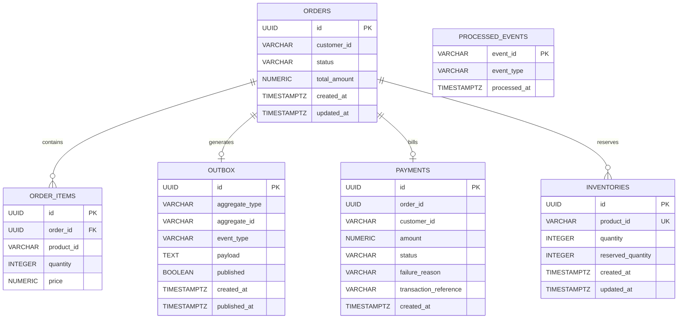

# Database Design & Architecture Specification

## Overview

The **Distributed E-Commerce Microservices Platform** adheres to the **Database-per-Service** design pattern. Each microservice encapsulates its own data store and data access logic, prohibiting direct cross-service database access. Communication between services occurs exclusively via asynchronous Kafka events (for Saga state transitions) or synchronous REST APIs (via the Reactive API Gateway).

---

## Why Database-per-Service?

1. **Loose Coupling & Autonomous Evolution**:
   Each service team can refactor schemas, migrate columns, and add tables without risking database locks, breaking foreign keys, or requiring synchronized multi-service deployments.
2. **Polyglot Persistence**:
   Different domains require different data models:
   - **Product Catalog** requires flexible, schemaless, polymorphic document storage with text search capabilities (fulfilled by **MongoDB**).
   - **Orders, Inventory, and Payments** require strict ACID guarantees, transactional isolation, and relational integrity (fulfilled by **PostgreSQL**).
3. **Failure Domain Isolation**:
   A database crash, slow query lock escalation, or high-volume write contention in the payment or inventory database cannot crash the product catalog or prevent customers from browsing items.
4. **Independent Scalability**:
   The read-intensive product database can scale using replica sets and read caches independently of write-heavy transactional databases backing order processing and payment transactions.

---

## Database Inventory

| Database Name | Technology | Hosting Service | Primary Purpose |
| :--- | :--- | :--- | :--- |
| `ecommerce_product_db` | MongoDB 7.0 | `product-service` | Dynamic product catalog, categories, attributes, and search |
| `ecommerce_order_db` | PostgreSQL 16 | `order-service` | Orders, line items, Saga state transitions, Transactional Outbox |
| `ecommerce_inventory_db` | PostgreSQL 16 | `inventory-service` | Stock levels, reserved stock, idempotent event processing |
| `ecommerce_payment_db` | PostgreSQL 16 | `payment-service` | Payment records, simulated transactions, idempotent refunds |

---

## Detailed Entity Schemas

### 1. `ecommerce_order_db` (PostgreSQL)

#### Table: `orders`
Represents customer purchase requests and tracks the choreography Saga lifecycle.

- **Primary Key**: `id` (`UUID`)
- **Fields**:
  - `id` (`UUID`, PK): Unique order identifier.
  - `customer_id` (`VARCHAR(255)`, NOT NULL): Unique identifier or email of the purchasing customer.
  - `status` (`VARCHAR(50)`, NOT NULL): Current lifecycle status (`PENDING`, `INVENTORY_RESERVED`, `CONFIRMED`, `CANCELLED`).
  - `total_amount` (`NUMERIC(19, 2)`, NOT NULL): Total computed price of the order items.
  - `created_at` (`TIMESTAMP WITH TIME ZONE`): Audit timestamp of creation.
  - `updated_at` (`TIMESTAMP WITH TIME ZONE`): Audit timestamp of latest modification.
- **Constraints**:
  - `status` CHECK (`status IN ('PENDING', 'INVENTORY_RESERVED', 'CONFIRMED', 'CANCELLED')`)
  - `total_amount` CHECK (`total_amount >= 0`)
- **Indexes**:
  - `idx_orders_customer_id` ON (`customer_id`): Optimizes customer order history lookups (`/api/orders/customer/{customerId}`).
  - `idx_orders_status` ON (`status`): Speeds up administrative filtering by status.
  - `idx_orders_created_at` ON (`created_at` DESC): Optimizes recent order sorting.
- **Relationships**: One-to-Many with `order_items` (Cascade delete on order removal).
- **Purpose**: Tracks order state and acts as the Saga initiator.

#### Table: `order_items`
Individual line items belonging to an order.

- **Primary Key**: `id` (`UUID`)
- **Fields**:
  - `id` (`UUID`, PK): Unique line item ID.
  - `order_id` (`UUID`, NOT NULL): Foreign key referencing `orders(id)`.
  - `product_id` (`VARCHAR(255)`, NOT NULL): Catalog product reference.
  - `quantity` (`INTEGER`, NOT NULL): Units purchased.
  - `price` (`NUMERIC(19, 2)`, NOT NULL): Unit price at moment of purchase.
- **Constraints**:
  - `fk_order_items_order` FOREIGN KEY (`order_id`) REFERENCES `orders(id)` ON DELETE CASCADE.
  - `quantity` CHECK (`quantity > 0`).
  - `price` CHECK (`price >= 0`).
- **Indexes**:
  - `idx_order_items_order_id` ON (`order_id`): Rapid traversal of items for an order.
  - `idx_order_items_product_id` ON (`product_id`): Catalog cross-referencing and sales reporting.
- **Purpose**: Preserves item purchase history and immutable pricing snapshots.

#### Table: `outbox`
Transactional Outbox table ensuring atomic dual-write consistency between PostgreSQL and Kafka.

- **Primary Key**: `id` (`UUID`)
- **Fields**:
  - `id` (`UUID`, PK): Unique event tracking identifier.
  - `aggregate_type` (`VARCHAR(255)`, NOT NULL): Aggregate category (e.g., `'Order'`).
  - `aggregate_id` (`VARCHAR(255)`, NOT NULL): Aggregate root ID (e.g., `orderId`).
  - `event_type` (`VARCHAR(255)`, NOT NULL): Type name (e.g., `'OrderCreatedEvent'`).
  - `payload` (`TEXT`, NOT NULL): Complete JSON serialization of the event payload.
  - `created_at` (`TIMESTAMP WITH TIME ZONE`): Insertion timestamp inside business transaction.
  - `published` (`BOOLEAN`, NOT NULL DEFAULT FALSE): Publishing status flag.
  - `published_at` (`TIMESTAMP WITH TIME ZONE`, NULL): Timestamp when Kafka producer acknowledged message.
- **Indexes**:
  - `idx_outbox_published_created` ON (`published`, `created_at`): Allows the outbox background poller to fetch unpublished records (`WHERE published = false ORDER BY created_at ASC`) in milliseconds without scanning large historical tables.
- **Purpose**: Prevents dual-write data loss or partial writes if Kafka is temporarily unreachable when an order is committed.

#### Table: `processed_events`
Idempotency tracking table storing processed event IDs to prevent duplicate execution.

- **Primary Key**: `event_id` (`VARCHAR(255)`)
- **Fields**:
  - `event_id` (`VARCHAR(255)`, PK): Unique UUID of the received Kafka event.
  - `event_type` (`VARCHAR(255)`, NOT NULL): Event classification (e.g., `InventoryReservedEvent`).
  - `processed_at` (`TIMESTAMP WITH TIME ZONE`): Audit timestamp of completion.
- **Purpose**: Enforces at-least-once to exactly-once processing semantics for Kafka consumers.

---

### 2. `ecommerce_inventory_db` (PostgreSQL)

#### Table: `inventories`
Warehouse stock levels and active Saga reservation holds.

- **Primary Key**: `id` (`UUID`)
- **Fields**:
  - `id` (`UUID`, PK): Internal inventory record identifier.
  - `product_id` (`VARCHAR(255)`, UNIQUE NOT NULL): Catalog product reference.
  - `quantity` (`INTEGER`, NOT NULL): Available units currently unreserved.
  - `reserved_quantity` (`INTEGER`, NOT NULL DEFAULT 0): Units held by active, unconfirmed Sagas.
  - `created_at` (`TIMESTAMP WITH TIME ZONE`): Record creation timestamp.
  - `updated_at` (`TIMESTAMP WITH TIME ZONE`): Record update timestamp.
- **Constraints**:
  - `uc_inventory_product_id` UNIQUE (`product_id`).
  - `chk_inventory_quantity` CHECK (`quantity >= 0`).
  - `chk_inventory_reserved` CHECK (`reserved_quantity >= 0`).
- **Indexes**:
  - `idx_inventory_product_id` UNIQUE ON (`product_id`): Direct O(1) product stock lookups.
- **Purpose**: Manages stock allocation, decrements available count, increments reservation holds, and releases holds during Saga compensation.

#### Table: `processed_events`
Identical idempotency guard table inside `ecommerce_inventory_db`.
- **Primary Key**: `event_id` (`VARCHAR(255)`)
- **Purpose**: Guarantees that duplicate `OrderCreatedEvent` or `OrderCancelledEvent` messages do not result in double reservation or double release.

---

### 3. `ecommerce_payment_db` (PostgreSQL)

#### Table: `payments`
Ledger of payment attempts, transaction IDs, statuses, and refunds.

- **Primary Key**: `id` (`UUID`)
- **Fields**:
  - `id` (`UUID`, PK): Unique payment ledger identifier.
  - `order_id` (`UUID`, NOT NULL): Associated purchase order UUID.
  - `customer_id` (`VARCHAR(255)`, NOT NULL): Customer identifier.
  - `amount` (`NUMERIC(19, 2)`, NOT NULL): Transaction charge amount.
  - `status` (`VARCHAR(50)`, NOT NULL): State (`PENDING`, `SUCCESS`, `FAILED`, `REFUNDED`).
  - `failure_reason` (`VARCHAR(255)`, NULL): Error or card decline description.
  - `transaction_reference` (`VARCHAR(255)`, NULL): Simulated gateway reference code (e.g., `TXN-UUID`).
  - `created_at` (`TIMESTAMP WITH TIME ZONE`): Transaction initiation timestamp.
  - `updated_at` (`TIMESTAMP WITH TIME ZONE`): Transaction terminal state timestamp.
- **Constraints**:
  - `status` CHECK (`status IN ('PENDING', 'SUCCESS', 'FAILED', 'REFUNDED')`).
  - `amount` CHECK (`amount >= 0`).
- **Indexes**:
  - `idx_payments_order_id` ON (`order_id`): Quick retrieval of payments per order.
  - `idx_payments_customer_id` ON (`customer_id`): Customer transaction audit history.
  - `idx_payments_status` ON (`status`): Administrative filtering.
- **Purpose**: Enforces financial integrity and maintains the state of completed and refunded payments.

#### Table: `processed_events`
Identical idempotency guard table inside `ecommerce_payment_db`.
- **Primary Key**: `event_id` (`VARCHAR(255)`)
- **Purpose**: Guarantees that duplicate `InventoryReservedEvent` or `OrderCancelledEvent` messages do not trigger duplicate credit card charges or double refunds.

---

### 4. `ecommerce_product_db` (MongoDB)

#### Collection: `products`
Schemaless JSON/BSON document store capturing product catalog metadata.

- **Document Structure**:
```json
{
  "_id": "670150d1a4e2c918a384f901",
  "name": "Apple MacBook Pro 16",
  "description": "M3 Max 36GB Unified Memory 1TB SSD Space Black",
  "price": 3499.00,
  "category": "Computers",
  "brand": "Apple",
  "imageUrl": "https://images.unsplash.com/photo-1517336714731-489689fd1ca8",
  "inStock": true,
  "attributes": {
    "screen_size": "16.2 inch",
    "processor": "Apple M3 Max",
    "storage": "1TB NVMe SSD",
    "color": "Space Black"
  },
  "createdAt": "2026-10-01T12:00:00.000Z",
  "updatedAt": "2026-10-01T12:00:00.000Z"
}
```
- **Indexes**:
  - `{ "category": 1 }`: Category catalog navigation.
  - `{ "brand": 1 }`: Brand filtering.
  - `{ "name": "text", "description": "text" }`: Full-text search across titles and product specs.
- **Purpose**: Provides rich, polymorphic search and catalog browsing without complex SQL join overhead.

---

## Entity-Relationship Diagram (Relational Services)


