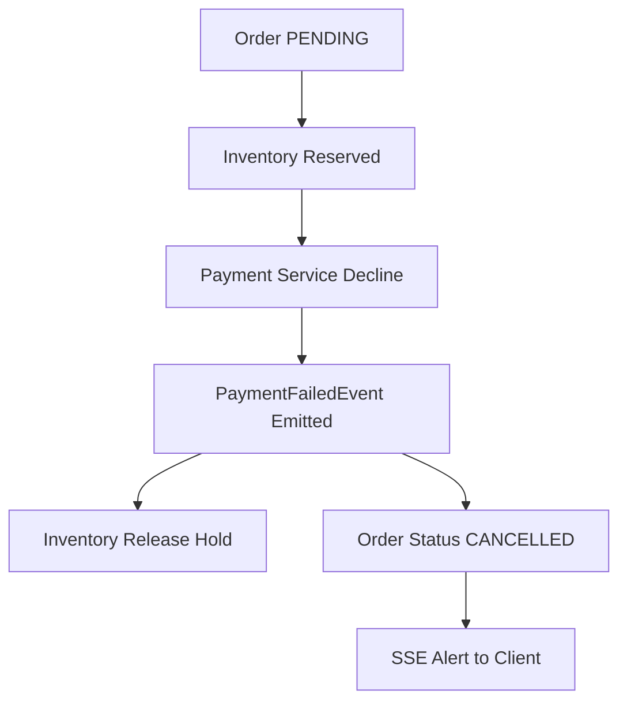
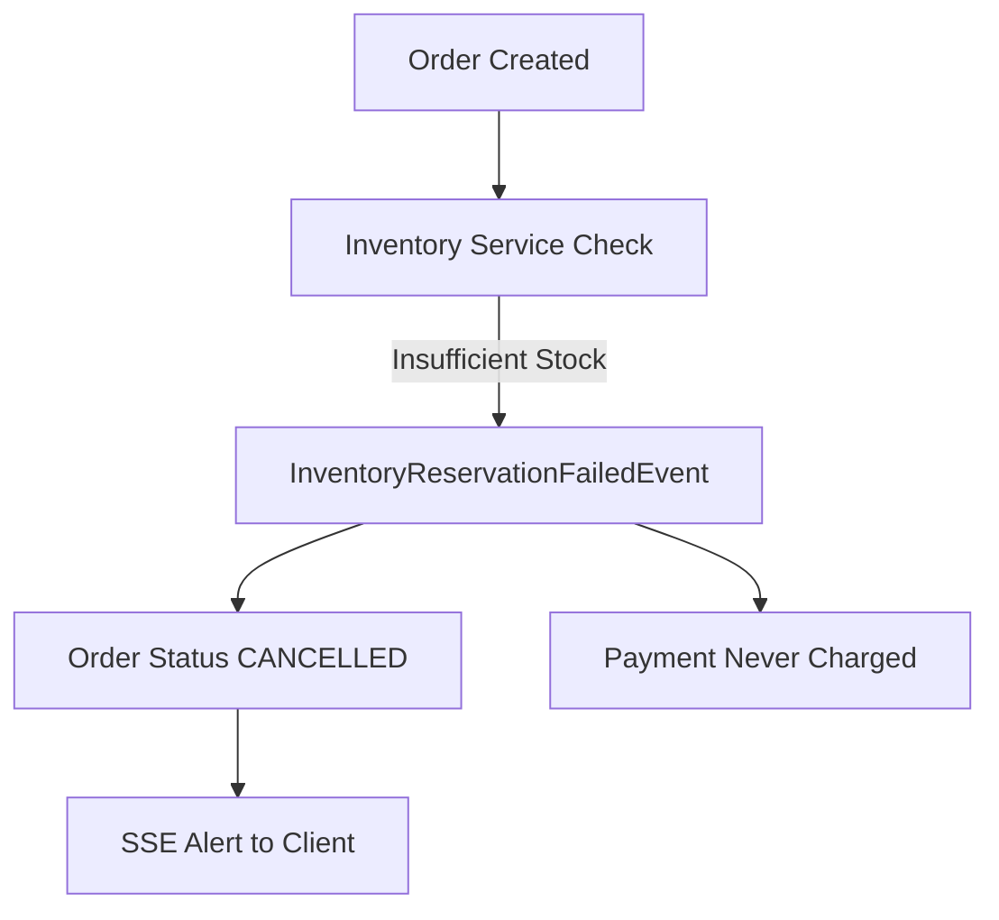
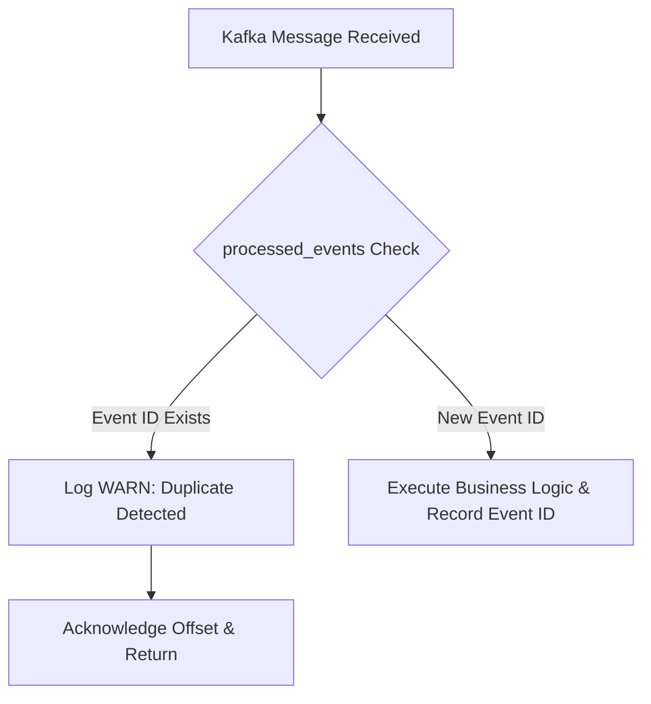
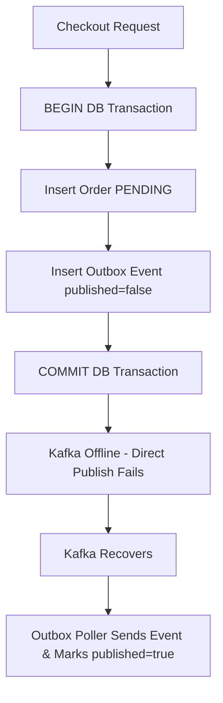

# Failure Scenarios & Distributed Resilience Matrix

## Overview

In a distributed, event-driven microservices architecture, network partitions, hardware outages, transient service downtime, and database write conflicts are inevitable. 

This document details the 10 core failure and recovery scenarios engineered into the **Distributed E-Commerce Microservices Platform**, outlining how each failure is detected, how the system behaves, what compensating actions are executed, and the final consistent state.

---

## Failure Scenarios

---

### Scenario 1: Payment Failure (Card Declined / Insufficient Funds)

1. **Failure**: Customer credit card declines due to insufficient funds or an expired expiration date during payment processing.
2. **Detection**: `PaymentService.processPayment()` catches payment gateway rejection or insufficient balance and records payment with status `FAILED`.
3. **System Behavior**: `PaymentKafkaProducer` publishes `PaymentFailedEvent` to topic `payment-events` tagged with the matching `orderId` and `correlationId`.
4. **Compensation / Retry**:
   - `inventory-service` consumes `PaymentFailedEvent`, locates the reserved stock for `orderId`, decrements `reserved_quantity`, increments `quantity`, and publishes `InventoryReleasedEvent`.
   - `order-service` consumes `PaymentFailedEvent`, validates state transition, and transitions order status to `CANCELLED`.
5. **Final State**:
   - `payment`: Record created with status `FAILED`.
   - `inventory`: Stock returned to available warehouse inventory.
   - `order`: Status `CANCELLED`.
   - `frontend`: Receives SSE cancellation alert in real-time.

---

### Scenario 2: Inventory Reservation Failure (Stock Shortage)

1. **Failure**: Customer attempts to order a quantity exceeding currently available stock for one or more items.
2. **Detection**: `InventoryServiceImpl.reserveInventory()` validates requested units against `inventory.getQuantity()`. Stock check fails.
3. **System Behavior**: `InventoryKafkaProducer` publishes `InventoryReservationFailedEvent` to `inventory-events`. No stock is deducted.
4. **Compensation / Retry**:
   - `order-service` consumes `InventoryReservationFailedEvent` and transitions order status directly from `PENDING` to `CANCELLED`.
   - `payment-service` never receives an `InventoryReservedEvent`, so no credit card charge or payment ledger record is ever created.
5. **Final State**:
   - `inventory`: Stock levels unchanged.
   - `payment`: No charge attempted.
   - `order`: Status `CANCELLED`.
   - `frontend`: Notified of stock exhaustion immediately.

---

### Scenario 3: Duplicate Kafka Event Delivery (Network Re-delivery / Consumer Rebalance)

1. **Failure**: A Kafka broker rebalances or consumer offset commit times out, causing the same event (e.g., `OrderCreatedEvent` or `PaymentCompletedEvent`) to be delivered to a consumer twice.
2. **Detection**: Every service queries its local `processed_events` table using the unique `eventId` from the payload:
   `processedEventRepository.existsById(event.eventId())`.
3. **System Behavior**: The query returns `true`. The duplicate event is immediately identified before executing any mutations.
4. **Compensation / Retry**:
   - No business logic or state changes are executed.
   - The method logs a duplicate event warning and returns immediately.
   - The Kafka consumer offset is acknowledged cleanly.
5. **Final State**:
   - No duplicate inventory holds.
   - No duplicate payment charges or refunds.
   - Complete exactly-once business processing semantics.

---

### Scenario 4: Kafka Broker Temporarily Unavailable During Order Creation

1. **Failure**: The Kafka cluster experiences transient network disruption or restart right as a user clicks checkout.
2. **Detection**: Direct Kafka publish attempt throws `KafkaException` / `TimeoutException`.
3. **System Behavior**:
   - Because the **Transactional Outbox Pattern** is implemented, the `Order` record and the `OutboxEvent` are written inside the same ACID PostgreSQL transaction (`@Transactional`).
   - The database transaction commits successfully.
   - The client receives HTTP 201 Created with order ID.
4. **Compensation / Retry**:
   - The `OutboxPublisherService` runs on a scheduled cadence (`@Scheduled(fixedDelay = 2000)`).
   - Once Kafka recovers, the poller reads unpublished outbox entries (`published = false`), publishes them to Kafka, and marks them `published = true`.
5. **Final State**:
   - Zero lost events or dropped orders.
   - Dual-write database/Kafka consistency is strictly maintained.

---

### Scenario 5: Payment Service Unavailable (Downtime / Pod Crash)

1. **Failure**: `payment-service` pod crashes or is being restarted while `inventory-service` emits `InventoryReservedEvent`.
2. **Detection**: `payment-service` consumer group is temporarily offline; Kafka broker continues to persist unconsumed messages on the `payment-events` topic.
3. **System Behavior**:
   - `inventory-service` has already reserved the items and completed its transaction.
   - The message remains queued in the Kafka partition without message loss.
4. **Compensation / Retry**:
   - Upon `payment-service` pod restart or recovery, the consumer reconnects to `payment-service-group`, reads uncommitted offsets, and executes the pending payment authorization.
5. **Final State**:
   - Saga resumes seamlessly without manual administrator intervention.
   - Order transitions to `CONFIRMED` upon delayed payment capture.

---

### Scenario 6: Inventory Service Unavailable During Checkout

1. **Failure**: `inventory-service` is temporarily unreachable when `order-service` publishes `OrderCreatedEvent`.
2. **Detection**: Kafka broker stores `OrderCreatedEvent` in topic `order-events` under consumer group `inventory-service-group`.
3. **System Behavior**:
   - Order remains in `PENDING` state in `ecommerce_order_db`.
   - No timeout causes data corruption.
4. **Compensation / Retry**:
   - When `inventory-service` restarts, it processes the pending backlog of order events in exact FIFO sequence by `orderId`.
5. **Final State**:
   - Reservations are created in sequence; Saga proceeds to payment and confirmation.

---

### Scenario 7: Database Outage (PostgreSQL Connection Pool Exhaustion)

1. **Failure**: PostgreSQL encounters a transient connection spike causing HikariCP pool exhaustion or database restarts.
2. **Detection**: Spring Data JPA throws `CannotCreateTransactionException` or `DataAccessException`.
3. **System Behavior**:
   - In Kafka listeners: The exception bubbles up to the Spring Kafka error handler.
   - Kafka listener does not acknowledge the consumer record offset.
4. **Compensation / Retry**:
   - Spring Kafka DefaultErrorHandler initiates redelivery backoff retries.
   - When PostgreSQL recovers, the transaction commits cleanly and the offset is committed.
5. **Final State**:
   - Consistent database state with no partial records or ghost entities.

---

### Scenario 8: Notification Service Failure (Email / SMS Gateway Outage)

1. **Failure**: Third-party SMS/Email gateway is down when `OrderConfirmedEvent` or `OrderCancelledEvent` is consumed.
2. **Detection**: `NotificationKafkaListener` logs exception while executing dispatch.
3. **System Behavior**:
   - Crucially, `notification-service` is a terminal downstream consumer in the Saga.
   - Its failure **never** rolls back or aborts the already confirmed order or captured payment.
4. **Compensation / Retry**:
   - Notification events are persisted or retried asynchronously via dead-letter retry queues without impacting core commerce operations.
5. **Final State**:
   - Order remains `CONFIRMED`.
   - Customer notification is delivered upon gateway recovery.

---

### Scenario 9: Network Timeout (Client Gateway Disconnection)

1. **Failure**: Mobile browser drops Wi-Fi or LTE connection right as `/api/orders` checkout request is dispatched.
2. **Detection**: API Gateway receives client socket disconnect; backend services process the request asynchronously.
3. **System Behavior**:
   - The order has already been created in PostgreSQL and outbox event published.
   - The Saga choreography completes autonomously in the background via Kafka.
4. **Compensation / Retry**:
   - When the client reconnects and queries `/api/orders/customer/{customerId}`, the order is displayed in its updated `CONFIRMED` status.
5. **Final State**:
   - Zero orphaned or half-processed transactions.

---

### Scenario 10: Downstream Service Recovery & State Reconciliation

1. **Failure**: A major downstream infrastructure outage halts one or more services for an extended duration.
2. **Detection**: Eureka Service Registry detects heartbeat absence and deregisters instances; Prometheus alerts trigger on consumer lag metrics (`kafka_consumer_fetch_manager_records_lag`).
3. **System Behavior**:
   - Upstream services continue accepting traffic (subject to Resilience4j circuit breakers and Kafka buffer limits).
   - Events accumulate safely in persistent, replicated Kafka partition logs.
4. **Compensation / Retry**:
   - Once services are redeployed, consumer groups resume reading from their last committed offsets.
   - Idempotency checks (`processed_events`) guarantee that any previously re-read messages are safely skipped.
5. **Final State**:
   - Consumer lag drops to 0.
   - All Sagas reconcile to either `CONFIRMED` or `CANCELLED`.
