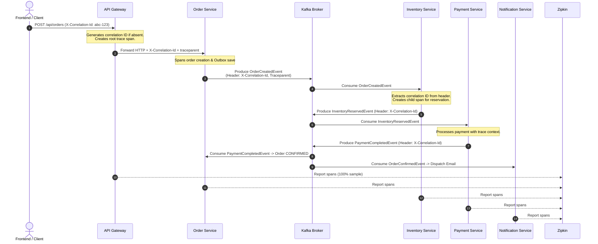

# Observability, Metrics & Distributed Tracing Guide

## Overview

The **Distributed E-Commerce Microservices Platform** provides production-grade observability combining **Metrics** (Prometheus & Grafana), **Distributed Tracing** (Micrometer Tracing & Zipkin), and **Correlation Tracking** (HTTP headers, Kafka headers, and SSE streams).

---

## 1. Metrics Collection Architecture

Every microservice exposes standardized Prometheus-formatted metrics at `/actuator/prometheus` via Spring Boot Actuator and `micrometer-registry-prometheus`.

### Metrics Inventory

| Metric Name | Type | Description | Source / Labels |
| :--- | :--- | :--- | :--- |
| `http_server_requests_seconds_count` | Counter | Total volume of HTTP requests handled | `application`, `uri`, `status`, `method` |
| `http_server_requests_seconds_max` | Gauge | Maximum latency of HTTP requests | `application`, `uri` |
| `http_server_requests_seconds` (5xx) | Counter | Rate of HTTP 5xx internal server errors | `application`, `status=~"5.."` |
| `jvm_memory_used_bytes` / `max_bytes` | Gauge | JVM Heap and Non-Heap memory footprint | `application`, `area="heap|nonheap"` |
| `process_cpu_usage` | Gauge | CPU percentage utilized by the microservice JVM | `application` |
| `kafka_consumer_fetch_manager_records_lag` | Gauge | Number of unprocessed records behind topic partition tip | `topic`, `client_id` |
| `saga_order_success_total` | Counter | Number of orders successfully reaching `CONFIRMED` status | `order-service` |
| `saga_order_failure_total` | Counter | Number of orders rolled back to `CANCELLED` status | `order-service` |
| `payment_failure_total` | Counter | Number of card declined / failed payment transactions | `payment-service` |
| `inventory_reservation_failure_total` | Counter | Number of stock shortages during checkout | `inventory-service` |

---

## 2. Accessing Observability Tools

### Prometheus
- **URL**: [http://localhost:9090](http://localhost:9090)
- **Role**: Time-series metrics collection engine.
- **Key Queries**:
  - `sum by (application) (rate(http_server_requests_seconds_count[1m]))` — HTTP traffic load.
  - `sum(saga_order_success_total)` vs `sum(saga_order_failure_total)` — Saga success/failure ratio.
  - `sum by (topic) (kafka_consumer_fetch_manager_records_lag)` — Kafka consumer lag.

### Grafana
- **URL**: [http://localhost:3001](http://localhost:3001)
- **Default Credentials**: Username: `admin` | Password: `admin`
- **Pre-provisioned Dashboard**: **Distributed E-Commerce Microservices Overview** (`uid: ecommerce-overview`).
- **Panels Included**:
  1. *Saga Orders Confirmed (Success)* — Green KPI stat card.
  2. *Saga Orders Cancelled (Rollback)* — Red KPI stat card.
  3. *Payment Authorization Failures* — Orange KPI stat card.
  4. *Inventory Reservation Failures* — Purple KPI stat card.
  5. *HTTP Request Rate by Service* — Multi-series timeseries chart.
  6. *HTTP Response Latency Max* — Milliseconds latency spikes.
  7. *HTTP Error Rate (5xx)* — Server error rates.
  8. *Kafka Consumer Lag by Topic* — Queue backlog monitoring.
  9. *JVM Heap Memory Usage (%)* — Memory headroom across all services.
  10. *Process CPU Usage (%)* — CPU load across all services.

### Zipkin (Distributed Tracing)
- **URL**: [http://localhost:9411](http://localhost:9411)
- **Role**: End-to-end distributed transaction tracing.
- **How to Trace an Order**:
  1. Open [http://localhost:9411](http://localhost:9411) in your browser.
  2. Search by service: `api-gateway` or `order-service`.
  3. Alternatively, search by Tag: `correlationId=<YOUR_ORDER_ID>`.
  4. Click on the trace to inspect span waterfalls:
     - `api-gateway` (HTTP Router)
     - `order-service` (Order POST + Outbox Insert)
     - `kafka` (Topic `order-events` publish)
     - `inventory-service` (Inventory Reservation)
     - `kafka` (Topic `inventory-events` publish)
     - `payment-service` (Payment Authorization)
     - `kafka` (Topic `payment-events` publish)
     - `order-service` (Status update to CONFIRMED)
     - `notification-service` (Customer receipt dispatch)

---

## 3. How Correlation IDs & Distributed Tracing Work

### Propagation Standards
1. **HTTP Headers**:
   - `X-Correlation-Id`: Human-readable tracking ID persisted across logs and HTTP response headers.
   - `traceparent` (W3C Trace Context) / `X-B3-TraceId` (B3 Propagation): Propagates 64-bit or 128-bit distributed trace and span IDs.
2. **Kafka Message Headers**:
   - Kafka producers attach `X-Correlation-Id` as byte-encoded headers on every `ProducerRecord`:
     `record.headers().add("X-Correlation-Id", correlationId.getBytes(StandardCharsets.UTF_8))`
   - Micrometer Tracing Brave instruments `KafkaTemplate` to inject W3C trace contexts into Kafka message headers automatically.
3. **Server-Sent Events (SSE)**:
   - When the frontend connects to `/api/orders/events/stream`, state change payloads include the originating `correlationId`, allowing the UI to link browser state with backend spans.
